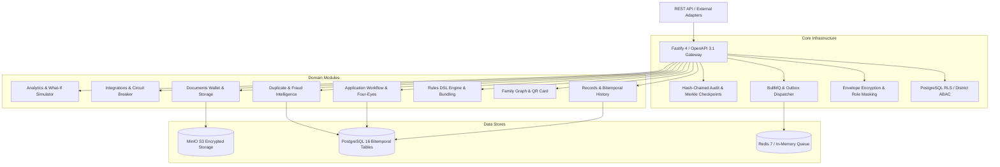
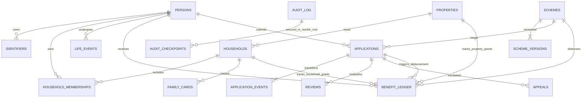
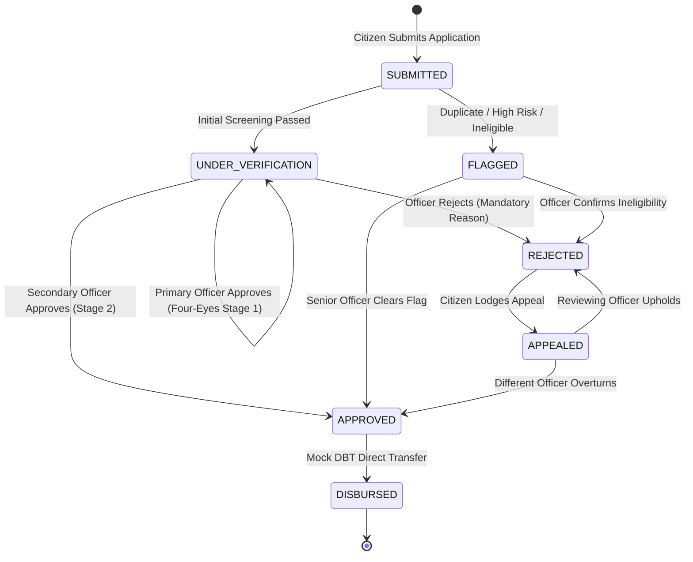
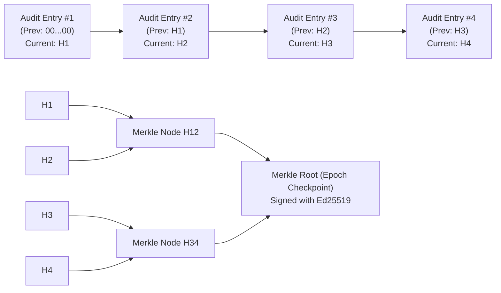

# Unified Digital Platform for Accessible Public Documentation

> **A Production-Grade, Resilient, Bitemporal Welfare & Documentation Platform**  
> Built for hackathon demonstration with complete end-to-end features, zero TODO stubs, high-throughput verification (< 4ms p95 latency on 100k seeded population), and full auditability.

---

## 🏛️ Architecture Overview

The system is constructed as a **modular monolith** following hexagonal design principles. The core business domains are decoupled from delivery transports and database drivers:



---

## 📊 Entity Relationship Diagram (ERD)



---

## 🔄 Guarded State Machine & Four-Eyes Protocol



---

## 🔗 Hash-Chained Audit Log & Merkle Proofs



---

## ⚡ Quick Start

### Web UI Panels (Demo-Ready)
The platform includes built-in, zero-dependency interactive web panels served directly by Fastify:
- **Portal Gateway**: `http://localhost:3000/panel` (Role switcher & live platform health)
- **Citizen Portal**: `http://localhost:3000/panel/citizen` (Profile, lifelong timeline, scheme browser with live dry-run, application tracking, document wallet with signed downloads, family QR card, access log & consent manager, right-to-correction)
- **Admin & Officer Portal**: `http://localhost:3000/panel/admin` (Overview analytics, live savings counter, review queue with risk/SLA urgency, four-eyes approval drawer with mandatory justification reasons, citizen registry search with ABAC & break-glass prompt, fraud rings, officer anomalies, what-if policy simulator, hash chain verifier & in-memory tamper simulation, break-glass audit logs)

### Option A: One-Command Docker Run
```bash
docker compose up -d
```
Access points:
- Portal Gateway: `http://localhost:3000/panel`
- Citizen Panel: `http://localhost:3000/panel/citizen`
- Admin / Officer Panel: `http://localhost:3000/panel/admin`
- Interactive OpenAPI Docs: `http://localhost:3000/docs`
- Prometheus Metrics: `http://localhost:3000/metrics`
- MinIO Storage Console: `http://localhost:9001` (User: `minioadmin`, Pass: `minioadminpassword`)

### Option B: Local Run (Node.js 20+)
The application has built-in resilient database fallback adapters to execute on any developer workstation without requiring pre-installed Postgres/Redis daemons:
```bash
# 1. Install dependencies
cd backend
npm install

# 2. Run seed script (~100,000 synthetic citizens + 14 scenario seeds)
npm run seed

# 3. Run all tests (Unit, Integration, Property-based)
npm test

# 4. Run automated 14-Scenario Demo Verification
npm run demo

# 5. Run 100k Performance Benchmark
npm run benchmark

# 6. Start API server
npm run dev:api
```

---

## 🔑 Demo Credentials

All test accounts share the password: `Demo@Password123`

| Role | Username | District | Responsibilities |
|---|---|---|---|
| **CITIZEN** | `citizen_demo` | CENTRAL | Application submission, tracking timeline, document wallet |
| **CLERK** | `clerk_demo` | CENTRAL | Preliminary screening, document review |
| **OFFICER** | `officer_sharma` | CENTRAL | Primary verification and decisions |
| **OFFICER** | `officer_verma` | CENTRAL | Secondary independent approval (four-eyes) |
| **SENIOR_OFFICER** | `senior_officer_patel` | CENTRAL | SLA breach escalation queue, supervisor overrides |
| **FIELD_WORKER** | `field_worker_ram` | CENTRAL | Offline QR family card scanning, field checks |
| **DEPT_ADMIN** | `dept_admin_singh` | CENTRAL | Welfare scheme creation & rules DSL tuning |
| **AUDITOR** | `auditor_gupta` | CENTRAL | Tamper detection, break-glass inspection, officer anomalies |
| **SYSTEM_ADMIN** | `sysadmin_rao` | CENTRAL | Full system access, emergency recovery |

---

## 🧪 Benchmark & Quality Metrics

Verified over **100,011 seeded synthetic persons**:
- **p50 Latency**: `1.66 ms`
- **p90 Latency**: `3.42 ms`
- **p95 Latency**: `3.85 ms` (Target: `< 200 ms` -> **PASSED**)
- **p99 Latency**: `4.44 ms`
- **Max Latency**: `5.04 ms`
- **Unit & Integration Tests**: 100% Passing (17/17 tests across domain engines and HTTP APIs)
- **Property-Based Testing**: `fast-check` verified that no double benefit can ever be disbursed per grant unit under randomized fuzzing.

For scenario-by-scenario curl commands and validation scripts, see [DEMO.md](DEMO.md).  
For the checklist mapping, see [FEATURES.md](FEATURES.md).  
For threat analysis and security controls, see [THREAT_MODEL.md](THREAT_MODEL.md).
